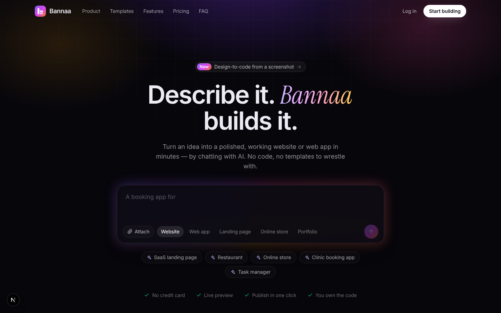
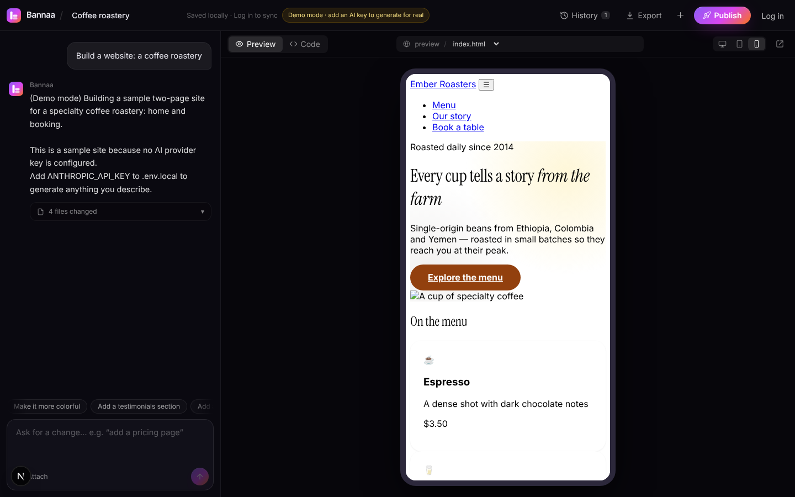

# 🧱 بنّاء — Bannaa

منصة لبناء المواقع والتطبيقات بالذكاء الاصطناعي عن طريق الوصف — **Describe it. Bannaa builds it.**
صِف فكرتك ← شاهدها تُبنى أمامك في معاينة حية ← عدّلها بالمحادثة ← حمّلها أو انشرها.

**واجهة المنصة باللغة الإنجليزية** بتصميم داكن احترافي (صفحة رئيسية كاملة: عرض حي متحرك، قوالب، مزايا، أسعار، أسئلة شائعة)،
بينما يستطيع المستخدم الكتابة بأي لغة — والمواقع العربية تُبنى من اليمين لليسار بإتقان.

| الصفحة الرئيسية | مساحة العمل |
|---|---|
|  |  |

## المزايا

| الميزة | الوصف |
|---|---|
| 💬 توليد من الوصف | موقع/تطبيق ويب متعدد الصفحات (HTML + Tailwind + JS) بتصميم احترافي ودعم كامل للعربية RTL |
| ⚡ بث مباشر | الملفات تظهر واحداً تلو الآخر أثناء كتابتها، والمعاينة تتحدث فوراً |
| 🛠️ تعديل ذكي | يرسل للنموذج الملفات الحالية ويستلم **الملفات المعدّلة فقط** (أسرع وأرخص) |
| 🩺 إصلاح ذاتي | المعاينة تلتقط أخطاء JavaScript وتطلب إصلاحها تلقائياً (محاولة واحدة) أو بزر «أصلحها» |
| 📱 معاينة الأجهزة | كمبيوتر / تابلت / جوال، والتنقل بين الصفحات يعمل داخل المعاينة |
| </> محرر كود | عرض وتعديل أي ملف يدوياً |
| 🕘 سجل النسخ | كل توليد/تعديل نسخة، مع استعادة بضغطة |
| 📦 تصدير ZIP | جاهز للنشر على Netlify Drop / Vercel / GitHub Pages / Cloudflare Pages |
| 🧩 قوالب | 8 قوالب جاهزة (SaaS، مطعم، متجر، حجز عيادة، مهام، ملف أعمال، فعالية، لوحة تحليلات) |
| 🔒 رمز دخول | `BANNAA_ACCESS_CODE` لحماية رصيدك قبل إضافة نظام الحسابات |
| 🧪 وضع تجريبي | يعمل بدون أي مفتاح لتجربة الواجهة بالكامل |
| 👤 حسابات | تسجيل/دخول بالبريد وكلمة المرور (scrypt + جلسة موقّعة httpOnly)، ونقل المشاريع المحلية للحساب تلقائياً |
| ☁️ حفظ سحابي | المشاريع تُحفظ في Postgres تلقائياً أثناء العمل، وتفتحها من أي جهاز |
| 🚀 نشر بضغطة | رابط عام `/s/<اسم>/` لكل موقع، مع تحديث وإيقاف النشر ومشاركة واتساب |
| 🖼️ صور ورؤية | إرفاق شعار/صور/لقطة تصميم (رفع، سحب وإفلات، لصق) — تُضغط وتُحفظ كأصول، ويراها النموذج ليحوّل التصميم إلى كود |
| 📊 حد يومي | `DAILY_LIMIT` لكل مستخدم للتحكم في التكلفة |

## التشغيل محلياً

```bash
cd platform
npm install
cp .env.example .env.local   # ثم ضع ANTHROPIC_API_KEY
npm run dev                  # http://localhost:3000
```

## مزوّد الذكاء الاصطناعي

| المتغير | المزوّد |
|---|---|
| `ANTHROPIC_API_KEY` | Claude عبر الـ SDK الرسمي (الافتراضي `claude-opus-5-5`، بجهد `high`، مع تفعيل `fallbacks` من جهة الخادم عند الرفض) — **موصى به** |
| `GEMINI_API_KEY` | Google Gemini (واجهة متوافقة مع OpenAI) |
| `OPENROUTER_API_KEY` | OpenRouter (حدد النموذج بـ `LLM_MODEL`) |
| `OPENAI_API_KEY` أو `LLM_API_KEY` + `LLM_BASE_URL` | أي خدمة متوافقة مع OpenAI |

خيارات إضافية: `CLAUDE_MODEL`، `CLAUDE_EFFORT` (low…max)، `CLAUDE_FALLBACKS=off`، `LLM_MODEL`، `LLM_MAX_TOKENS`.

## النشر على الإنترنت (Vercel + Supabase)

1. **قاعدة البيانات:** أنشئ مشروعاً مجانياً في [supabase.com](https://supabase.com) ← Project Settings ← Database ← انسخ
   **Connection string (Transaction pooler)**. الجداول تُنشأ تلقائياً عند أول طلب (أو نفّذ `db/schema.sql`).
2. ارفع المستودع على GitHub.
3. في [vercel.com/new](https://vercel.com/new) استورد المستودع، واختر **Root Directory = `platform`**.
4. أضف متغيرات البيئة: `ANTHROPIC_API_KEY`، `DATABASE_URL`، `AUTH_SECRET` (`openssl rand -hex 32`)،
   واختيارياً `DAILY_LIMIT` و`REQUIRE_LOGIN=true`.
5. Deploy. (المسار `/api/generate` مضبوط على `maxDuration = 300` ثانية — يحتاج خطة تسمح بذلك.)
6. (موصى به) أضف نطاقاً ثانياً للمواقع المنشورة مثل `sites.example.com` لنفس المشروع في Vercel، وضع `SITES_URL=https://sites.example.com`.

> **أمان المواقع المنشورة:** كود المستخدمين لا يعمل أبداً بصلاحيات المنصة. على نفس النطاق تُخدم المواقع بترويسة
> `Content-Security-Policy: sandbox` (أصل معزول لا يرسل كوكيز المنصة)، مع بديل في الذاكرة لـ localStorage.
> ومع `SITES_URL` تُخدم من نطاق منفصل تماماً. كل طلبات التعديل في الـ API محمية من CSRF بفحص `Origin`.

## البنية

```
platform/
├── app/
│   ├── page.tsx              الصفحة الرئيسية (Hero + عرض حي + قوالب + مزايا + أسعار + FAQ)
│   ├── build/page.tsx        مساحة العمل
│   ├── login/                تسجيل الدخول / حساب جديد
│   ├── s/[slug]/[[...path]]  خدمة المواقع المنشورة
│   └── api/
│       ├── generate/         بث التوليد (+ صور، حد يومي)
│       ├── auth/             register · login · logout · me
│       └── projects/         CRUD + publish
├── components/               Workspace, ChatPanel, CodePane, HeroPrompt, icons, landing/*
├── lib/
│   ├── prompts.ts            تعليمات النظام (البناء/التعديل) وبروتوكول الإخراج
│   ├── parse.ts              محلل الإخراج المتدفق (FILE/DELETE/PLAN/NOTES)
│   ├── preview.ts            تجميع المعاينة + جسر الأخطاء والتنقل
│   ├── llm.ts                المزوّدون (Claude / OpenAI-compatible / تجريبي)
│   ├── storage.ts            حفظ المشاريع والنسخ في المتصفح (للزوار)
│   ├── cloud.ts              عميل الحسابات والحفظ السحابي والنشر
│   ├── assets.ts             ضغط الصور وتحويلها لأصول
│   └── server/               db (Postgres/ملف) · auth · validate · sites
│   └── templates.ts          القوالب
├── db/schema.sql             مخطط قاعدة البيانات (يُطبّق تلقائياً)
└── tests/                    اختبارات الوحدات (npm test)
```

## خارطة الطريق

- ✅ **المرحلة 2:** الحسابات، الحفظ السحابي، النشر بضغطة، الصور وتحويل التصميم إلى كود، الحد اليومي.
- **المرحلة 3:** الباقات والدفع (Moyasar / Tap / Paymob) ونقاط الاستهلاك، نطاقات خاصة للعملاء، تصدير إلى GitHub،
  نماذج تواصل تستقبل الرسائل فعلياً، تطبيقات بخادم وقاعدة بيانات (بيئة تشغيل معزولة)، استعادة كلمة المرور بالبريد.
- **المرحلة 4:** تطبيقات الجوال، العمل الجماعي، لوحة إدارة، سوق قوالب.
